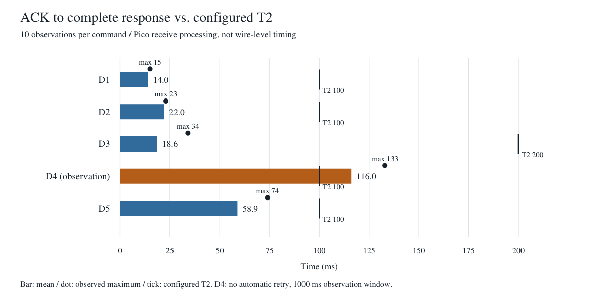

# D1からD5の受信時間と待ち時間の妥当性確認

実施日: 2026-11-11 JST。ATE測定11:30:17～11:30:31、D4観測は11:32台。対象はCOM6の治具Pico（unique_id=69f7d45962cfdfad）、製品FWは末尾空白を含む`S1.13 `、PS_ON=1／BATT_ON=0。

各コマンド10回、計50回の完全応答受信時刻を取得した。D1／D2／D3／D5は現行T2のまま各10回正常完了した。D4は再送を止めた独立した観測で10回とも完全応答を取得したが、ACK後113～133msであり、全回で現行T2=100msを超過した。**この構成でD4の完全応答を待つには100msが不足するという結果である。** 製品用コード・T2設定は変更していない。

## 平均時間と現行T2の比較

単位はすべてms。平均は各コマンドの10標本の算術平均。T2と比較する対象は「ACK→完全応答」であり、「送信→完全応答」の全時間ではない。

| コマンド | 回数 | 送信→ACK 平均 | ACK→完全応答 平均 | 送信→完全応答 平均 | ACK後の最大 | 現行T2 | T2−観測最大 | T2以内 |
|---|---:|---:|---:|---:|---:|---:|---:|---:|
| D1 | 10 | 6.5 | 14.0 | 20.5 | 15 | 100 | +85 | 10／10 |
| D2 | 10 | 6.2 | 22.0 | 28.2 | 23 | 100 | +77 | 10／10 |
| D3 | 10 | 6.8 | 18.6 | 25.4 | 34 | 200 | +166 | 10／10 |
| D4 観測用 | 10 | 6.1 | 116.0 | 122.1 | 133 | 100 | −33 | 0／10 |
| D5 | 10 | 6.1 | 58.9 | 65.0 | 74 | 100 | +26 | 10／10 |

D1／D2は今回の正常系でそれぞれ85ms／77msの観測余裕があった。D3も200ms内に収まったが、規定の200msを短縮するための評価は行っていない。D5は最大74msで、正常完了した4コマンドでは余裕が最小の26msだった。10回の結果だけで、全FW・全動作状態・長時間運転の上限や保証余裕を定めることはできない。

D4は平均でも100msを16ms超え、最大では33ms超過した。既存D4-TIM-01の、100ms途中でのCommand Retryと遅延フレームの競合という課題と整合する観測である。ただし、製品の線上送信時刻を測っていないため、製品FW違反や単一の原因とは断定しない。次は製品側T2の定義・送出時刻と、Pico側の受信バックログ・処理負荷を照合してから、仕様／実装のどちらを修正するか決める。D4量産不使用方針とT2=100msは維持し、OIをCloseしない。

## 測定方式と比較範囲

### D1 D2 D3 D5

既存のATE経路でSTATUS_REFRESH、D2_REFRESH、D3_REFRESH、INFO_REFRESHを各10回送信した。Command Retry／Response Retry、Cache、Logger、受信処理は通常の実装を使用した。D1／D2／D3／D5の応答DATA長は各15／30／21／100文字で、40回すべてProtocol OK、再送0、ambiguous=False。

D2の受付条件確認のため、D1後にPS_ON=1、BATT_ON=0、RESTART_READY=0を確認し、測定時の日本時間でCLOCK_SYNCを1回明示実行した。SCは準備であり各10回の平均へ含めていない。要求は前応答受信後150ms以上空け、Transactionを重ねていない。

### D4

過去にT2=100msで応答途中の再送競合が発生しているため、同じPico上で既存のUART・フレーム受信・BCC検証・RAM Loggerを使う測定処理をRAMだけに読み込んだ。通常のD4_MAINT_READが100ms設定で10回成功したという結果ではない。

この処理は1コマンドだけを送信し、自動Command Retry／Response Retryを行わず、完全フレームを最長1000ms観測して、正しいD4 DATA212文字を受信した後にACKを返す。1000msは測定窓であり、製品用T2の変更・採用値ではない。観測結果をProtocol SUCCESSへ変換せず、CSVにはTIMING_OBSERVATION／OBSERVEDとして記録した。

通信中はbusyを立てSD write／flushを行わず、間隔中に通常のLogger処理を行った。各D4前にDATA／D4 CacheをINVALIDにし、観測応答をVALID Cacheへ採用していない。開始時に製品状態とFWも再確認した。製品ファイルは一切配置・変更していない。

### 時刻の意味

すべての集計はSD CSVのPico RAW Loggerのticks_msに揃えた。送信はUART writeが戻った後のTX RAW記録、ACKはRX ACK記録、完全応答はSTX～BCCを受信し終えたRXフレーム記録である。送信→完全応答は、この2つのRAW時刻差であり、最終ACK送信やATEのPC往復時間は含まない。

これは1ms単位のソフトウェア記録で、線上の送信開始／終了をオシロスコープ等で測定した値ではない。D4は独立した観測モードのため、通常ATE処理との実行条件差がある。D4のRAM保存時刻でも照合し、CSVとの差は1標本で1ms、他9標本は0msだった。比較表は全コマンドで統一してCSVの時刻を使用した。

## 各回のACK後完全応答時間

| 回 | D1 | D2 | D3 | D4 観測用 | D5 |
|---:|---:|---:|---:|---:|---:|
| 1 | 13 | 23 | 17 | 114 | 56 |
| 2 | 14 | 21 | 17 | 114 | 57 |
| 3 | 13 | 22 | 18 | 113 | 57 |
| 4 | 14 | 21 | 16 | 133 | 58 |
| 5 | 14 | 21 | 16 | 114 | 58 |
| 6 | 14 | 23 | 16 | 113 | 74 |
| 7 | 15 | 23 | 18 | 115 | 58 |
| 8 | 15 | 22 | 34 | 116 | 57 |
| 9 | 13 | 22 | 17 | 114 | 58 |
| 10 | 15 | 22 | 17 | 114 | 56 |

## 記録の確認と終了状態

| 記録 | SD原本とPC回収 | 内容の確認 |
|---|---|---|
| T000005 | 20261111_113018_T000005.csv、25195byte、SHA-256一致 | D1／D2／D3／D5各10＋SC1、送受信82フレームBCC一致、308データ行・全14列 |
| T000006 | 20261111_113232_T000006.csv、10841byte、SHA-256一致 | D4観測10回、送受信20フレームBCC一致、57データ行・全14列 |

両方のSD原本を256byte単位で回収し、長さと全体SHA-256を照合した。平均・最大・標本数はRAW CSVから別計算でも再検算し一致した。SCは測定母数から除外し、失敗を成功標本へ置換したり、再送を独立標本として数えたりしていない。

各試験の終了時はTEST_LOGGER=OK、TEST_LOG_DROP=OK、累積破棄0、SD正常。回収後に通常アプリを再開し、ID応答・通信IDLE・SD／自己診断正常・破棄0を再確認、COM6／COM20を解放した。

D3は寿命計算データ消去、D4は瞬断回数消去を伴う要求として実施した。D2受信後のSLによる消去条件にも関係するが、今回はSLを送っていない。SC以外の製品設定・SS／FU、電源・負荷・バッテリ操作は行っていない。製品PASS／FAILを判定した結果ではない。

## 証跡と再計算

- [ATE送受信](ate_sequence.json)、[D4 RAM観測結果](d4_observation.json)、[回収・機器・復帰記録](recovery.json)
- [集計値と各回の3区間の時刻](timing_analysis.json)、[独立再検算](calculation_validation.json)
- [ATE試験CSV](20261111_113018_T000005.csv)、[D4観測CSV](20261111_113232_T000006.csv)
- [ATE測定スクリプト](run_ate_measurement.py)、[D4 RAM測定コード](d4_ram_probe.py)、[分割回収スクリプト](recover_and_run_d4.py)、[再計算スクリプト](analyze_timing.py)
- [比較図SVG](timing_comparison.svg)
