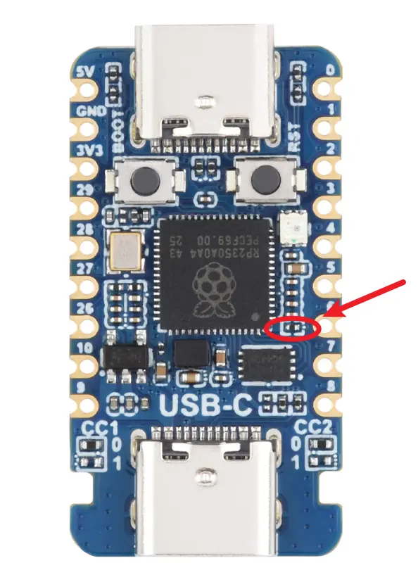

# Type_C2 Host回路条件・変更案 Rev.0

日付: 2026-11-11
対象: Waveshare RP2350-USB-C（USB serial A06FEA01012EC137）、Type_C2＝BCR-TC2D1BK固定
状態: **信号・CCの必要条件と部品変更案を特定。給電運用はユーザー指定済み。実装変更・Host動作・給電保護の受入は未実施。**

## 1. 今回固まった条件と残る確認

| 区分 | 条件 | 状態 |
|---|---|---|
| 接続 | Type_C2はQR、Type_C1は7355。ハブ・ポート入替えなし | 既存要求を維持 |
| デバッグ給電 | PC→Type_C1。機器未接続でUSB単体診断 | ユーザー指定。今回の開発FWのまま |
| QR／DMM使用時給電 | 外部5Vアダプタ→Expander分岐→下位基板の5V系統。追加枝で1Aまで取れるとの申告 | ユーザー指定。供給経路・定格を申告事実として採用、負荷・保護は未測定 |
| 電源切替え | PC VBUSとExpanderの5Vを直結して同時給電しない。切替え時は無給電にする | 両USB VBUS／VSYS直結の回路に基づく必須運用 |
| D線 | D+=GPIO12、D−=GPIO13 | 原典の接続線とメーカーUSB-C専用設定で一致 |
| D+プルアップ | R13の1.5kΩプルアップをHost時に使わない | USB-C専用FAQに撤去位置と指示あり |
| CC | Sink用Rdを外し、5V基準のDefault USB Power用Rpを両CCへ設定 | 変更案: R20／R21各56kΩ、1%（適合サイズは現物確認） |
| 供給電流広告 | Default USB Power。1.5A／3A広告はしない | 1Aの供給枠から大電流広告を推定しない |
| 実施境界 | 部品変更は改造担当者の現物照合と人間確認後。QR接続・Host FW配置は変更後受入の後 | 未実施。USB-SUB-01／02はOpen |

ここで「必要条件を特定」とは、基板改造済み・量産採用済み・USB規格試験合格を意味しない。供給枝の1Aは申告値であり、電流制限・逆流防止・短絡保護の実在や動作を確認した値ではない。

## 2. 先のD線説明の訂正

回路図を接続線まで拡大し、メーカーのRP2350_USB_C=1用pio_usb_configuration.hと照合した。以前の説明と記録にある「GPIO13=D+／GPIO12=D−」「R13はD−側」は誤り。

| 信号 | 正しい接続 | プルアップ |
|---|---|---|
| D+ | Type_C2 DP1(A6)／DP2(B6)=DB_P → R12 27Ω → GPIO12 | MCU側にR13=1.5kΩで3V3へ |
| D− | Type_C2 DN1(A7)／DN2(B7)=DB_N → R11 27Ω → GPIO13 | MCU側にR10=NC/1.5kΩ候補で3V3へ。Hostでは未実装を維持 |

DB_N＝Type_C2 DN1／DN2という回答自体は正しいが、そこをR13確認用に測る案内が誤っていた。ユーザーは測定不可能と回答しており、D線抵抗の実測値は得ていない。測定不可から異常を推定しない。今後も微細DB_N／DN1へのプロービングは要求しない。

またType_C1のCC各5.1kΩは、R5／R6を介してGNDへ接続される。既存計画・チェックリスト・資料台帳の「VSYS側」という説明も訂正対象。VBUSがVSYSへつながることとCC抵抗の接続先を区別する。Type_C1のHost化／改造条件は本書では確定しない。

[Type_C2回路図の拡大描画](../reference/USB_Host_SubMCU_Host_Conditions_20261111/Type_C2_schematic_zoom.png)。元PDFは変更していない。取得し直した現行メーカーPDFのSHA-256は保存済み原典と一致（35f3fd0960f1af50c592da0befcb716e2b6c5cfea4fc41f7f7ceb4c27577453d）。

## 3. Type_C2の部品変更案

基板は部品面を上、BOOT／RSTとPC用Type_C1を上に置いた向きで説明する。これは実施案であり、今回まだ部品を動かしていない。

| 対象 | 現状／原典 | Host向け変更案 | 位置の根拠 |
|---|---|---|---|
| CC1の0位置 | R19=5.1kΩ、GND側。ユーザーが実装ありと回答 | 外して未実装にする | Type_C2左側のCC1、0=Sink |
| CC1の1位置 | R21=NC、VSYS側 | 56kΩ・1%を新規実装 | Type_C2左側のCC1、1=Source |
| CC2の0位置 | R18=5.1kΩ、GND側。ユーザーが実装ありと回答 | 外して未実装にする | Type_C2右側のCC2、0=Sink |
| CC2の1位置 | R20=NC、VSYS側 | 56kΩ・1%を新規実装 | Type_C2右側のCC2、1=Source |
| D+プルアップ | R13=1.5kΩ（原典）、写真上にも部品あり | メーカーFAQの丸囲み位置を照合して撤去 | 下記のUSB-C専用位置写真。PIO-USBをDeviceへ使えなくなる |
| D−プルアップ候補 | R10=NC/1.5kΩ（原典） | 未実装を維持。実装ありなら無断でそのままHost試験しない | D−側の回路を参照。実物部品の対応は担当者確認 |
| D線直列抵抗 | R11／R12=27Ω | 維持。取り外さない | MCUとUSBコネクタ間 |
| Type_C1のCC | R5／R6=5.1kΩ | 今回は変更しない | PCデバッグ用Device接続を維持 |

[メーカーUSB-C専用FAQ](https://docs.waveshare.com/RP2350-USB-C/FAQ)の位置写真を使用した。USB-A版のR番号やUSB-CM版の写真を流用しない。R13の部品位置が写真と現物で一致しない場合はそこで止め、別部品を推定して除去しない。抵抗の実装サイズは写真だけで発注用に確定していない。既存5.1kΩの単純移設・0Ω短絡・SinkとSourceの両側実装は採らない。

56kΩは、5V基準でDefault USB Powerを示すRpの値を一次資料と照合したもの。1%は今回の部品選定案で、メーカーBOMの指定と称していない。1A供給可能でも22kΩ（1.5A）／10kΩ（3A）を採らない。CC電圧の参考計算は、相手が5.1kΩ Rdなら5×5.1/(56+5.1)≈0.417V。これは理想値の計算であり、合否許容差や新しい必須測定ではない。

## 4. VBUS・電源の成立条件

### 給電源の切替え

両ポートのVBUSと5V／VSYSは原典で同じネット。PCと外部5Vを同時に直結すると給電源同士が接続される。今回の単純構成では次の運用を採る。

| モード | Type_C1 | Expander分岐5V | Type_C2 | 用途 |
|---|---|---|---|---|
| PCデバッグ | PCのみ | 外す／給電経路を物理的に切離す | 空 | 現行確認用FW、USB CDCの版・PING等 |
| 機能評価 | 7355または必要時空。PCは外す | 外部アダプタからの分岐で給電 | QR | 今後のHost FWによる単体・共存試験 |
| 同時PCデバッグを追加したい場合 | 通常USB直結を追加しない | 給電構成を再設計 | 固定機器 | USB電源分離／逆流防止を別途設計してから。今回の確定範囲外 |

追加基板の5V入力とGNDを使い、3V3端子へ5Vを入れない。既存治具PicoのGPIOから給電しない。Pico側というユーザー指定は、外部アダプタのExpander分岐を意味するものとして記録する。信号・電源用ケーブルの端子／極性・定格を現物で照合してから施工する。

### 電流と保護

初期の予算式は、追加枝の必要電流=下位基板最大電流＋QR最大電流＋7355のUSB側電流＋設計余裕。QRの公開値230mAを引いても、1Aとの差770mAをそのまま余裕の実測値としない。下位基板・7355のUSB側電流、突入、Expanderの既存負荷とアダプタ全体の能力は未測定。

- 追加枝がユーザー指定の1A以下で保護されること、ケーブル・端子・Expanderの定格がそれを満たすことを確認する。定格1Aという申告だけから電流制限器やヒューズの存在を推定しない。
- QRの投入・読取・再接続で5V低下や下位基板／既存治具のresetがないことを実測する。5V／3.3Vの既得値は無負荷の電圧情報で、負荷時の成立とは別。
- 7355からのVBUS逆給電の有無は実機・配線で確認する。自己給電測定器だからUSB側は0mA・逆流なしとは推定しない。
- 量産設計は、CCの接続検出に連動したVBUS ON/OFF、切断時放電、過電流・逆流・ESDの扱いを確定する。抵抗と直結VBUSだけで汎用Type-C Sourceが完成したとしない。

メーカー回路はVBUS常時直結であり、実測でも無接続のType_C2に5Vが出た。初期の限定評価でこれを使用するなら、QRだけの固定接続、無給電での配線、接続後の電源投入、終了後の電源OFF、供給枝の電流保護を条件にする。汎用の活線挿抜可能なType-C Source／量産回路としての承認は別工程。

現行dev-20261111.1のUSB CDC記述子はSDK既定の250mAを使用する。このPCデバッグFWのままQRの給電まで含めたPCバスパワー構成を採用しない。ユーザー指定どおり機器使用時はPC給電を外し、Expander側へ切り替える。

[MicrochipのCC解説](https://developerhelp.microchip.com/xwiki/bin/view/applications/usb/typec-features/cc-vconn-signals/)はRpと供給電流広告、[Richtek AN056](https://www.richtek.com/en/design-support/application-notes/an056)はSourceのVBUSスイッチと検出動作、[TIのSourceコントローラ資料](https://www.ti.com/product/TPS25821)はCC検出・電源スイッチ・電流制限の機能を説明する。これらは機能の根拠であり、今回特定ICの発注・採用を決定したものではない。

## 5. FW側の前提

メーカーUSB-C設定のRP2350_USB_C=1はpin_dp=12、pinout=PIO_USB_PINOUT_DPDMで、D−は13。120MHzの例とPIO TX/RX・DMA割当てはメーカーサンプルに記載されるが、今回のHost FWとしてまだ採用・実機検証していない。

サンプルのUSB Host処理はPIO側roothub1、ネイティブUSB側はCDC Deviceの例。これは7355のネイティブHostとQRのPIO Hostを同時運転した証拠ではない。gpio_pull_downの設定はPIOプログラムの初期化に存在する。内蔵プルダウンの使用をもって全USB電気特性の規格適合とはしない。

公式C/C++説明にある非void関数のreturnをコメントアウトする対処は、そのまま製品用互換修正に採用しない。将来のHost FWでは依存APIを正しく実装・版固定し、今回のUSB単体確認FWを上書きする場合は別開発版にする。

現在の確認FW dev-20261111.1はUSB Hostを起動しない。部品変更だけでQRを読める状態にはならない。機能評価時のログ経路はType_C1を7355へ使うためUSB CDCとは別途準備する。既存の治具UARTピン・内部フレームを推測して先行接続しない。

## 6. 変更後の受入と人間確認

| 段階 | 作業 | 確認点・記録 |
|---|---|---|
| H0 人間確認 | 本変更案と部品位置、電源枝の保護をレビュー | Host専用化の了承、抵抗サイズ・値、担当者、電源図。未確認で部品を動かさない |
| H1 無給電の施工 | PC・外部電源・機器を全て外しR13／Rd／Rpを処置 | 変更前後の部品写真、除去部品、56kΩ部品識別。R11／R12とType_C1の抵抗は維持 |
| H2 電源のみ | Type_C2の機器なし、選択した1系統から給電 | 既に測れるブレークアウトと電源ピンで5V／3.3V、異常消費・resetなし。DB_N微細端子の抵抗測定は要求しない |
| H3 QR専用 | PCを外し、QRをType_C2へ無給電で接続後、保護した分岐5Vを投入 | Host FWと版、5V電流／突入、列挙VID/PID、実機HID報告、35文字完全一致 |
| H4 向き・再接続 | 初期評価は電源OFFでCプラグの向きを変え再投入 | 両向き成立、欠落・重複なし。活線挿抜はVBUS制御条件を別に確認後 |
| H5 7355併用 | Type_C1へ7355、Type_C2へQR、Expander給電 | 両Host、USB側負荷／逆流、既存治具のTiming。未確定仕様を補完せず別工程で実施 |

初回受入チェックリスト§3の「回路改造の要否は人間確認なしに決定しない」に従い、ここまでを具体化した変更案とする。ユーザー指定の給電方針は確定として反映したが、保護回路・部品施工の承認や未実施試験の合格を代行しない。USB-SUB-01／02はCloseしない。

## 7. 根拠・検証・変更範囲

- [一次資料台帳](../reference/USB_Host_SubMCU_Host_Conditions_20261111/manifest.json): メーカーFAQ・USB-C専用写真・サンプル・半導体メーカー解説を取得元とSHA-256付きで保存。
- メーカーコード固定commit: 774cbb1e8ecc9d5cc8474ba9feb90a0939047f3b。ファイル名・取得元は台帳を参照。
- 原典PDF1ページの描画・拡大接続線を確認。メーカー写真、実機写真、基板別コードと照合してD線の説明誤りを訂正。
- 原典・実機・配布済みUF2は変更しない。通信コード・テストコード変更なし。今回は回路条件の資料照合でありHost／Mock再実行・基板改造・Host実機試験は行っていない。前回の287件／USB123項目×2は確認FWの別範囲の実績。

関連: [電源実測と測定制約](USB_Host_SubMCU_Power_Check_20261111.md)、[確認用FW受入](USB_SubMCU_FW_Acceptance_20261111/Result.md)、[Open Issues](Open_Issues.md)。

## 改造の実施時期・図面への反映（2026-11-11）

ユーザーから「実機確認前に指示」「治具回路図に改造個所と手順を明記」と指示を受領。今は施工せず、Host FW・ログ・給電保護の準備後、実機確認の直前に改造内容を案内する。[治具図Rev.4](drawings/NF55G_Fixture_20261111_Rev4/README.md)の4枚目へ改造回路・位置・部品表、5枚目へ無給電での施工・確認順・給電切替えと記録欄を追加した。旧図面と原典は保持、基板改造は未実施。
