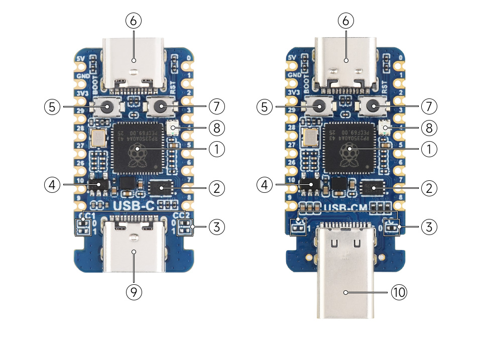

# RP2350-USB-C PC接続ポートの見分け方

日付: 2026-11-10
状態: USB未検出。ユーザーよりType_C1／Type_C2の区別が分からないとの回答あり。

左側のRP2350-USB-C写真を基準に、チップと2つのボタンが見える面を上にする。

- ⑥: BOOT／RSTの2つのボタンに隣接するUSB-C。書込み用Type_C1。ここをPCへ接続する。
- ⑨: 2つのボタンから遠い反対端のUSB-C。PIO-USB側Type_C2。今回の初回識別では空にする。
- ⑤: BOOTボタン。
- ⑦: RUN／RSTリセットボタン。

ポート⑥へデータ対応USBケーブルでPC接続後、⑤を押したまま⑦を一度押して離し、最後に⑤を離す。7355・QR・治具UARTは外したまま。完了後にWindows側でUSB機器とドライブを再列挙する。

公式出典: https://docs.waveshare.com/RP2350-USB-C
画像出典: https://docs.waveshare.com/assets/images/RP2350-USB-C-details-inter-4b1e6b9b69e0292117cec518117553c9.webp
画像は公式原図を変更せず別ファイルに保存した。現物の基板版一致は別途確認する。

直前の再検出結果はUSB機器一覧に対象基板なし、Get-Volumeに書込みドライブなし、serial.tools.list_portsはno ports found。接続先の現物識別を優先し、原因や故障は断定しない。FW書込み・対象機器への送信は未実施。

## ポート位置案内後の再確認（2026-11-10）

ユーザーの接続連絡を受けて再列挙した。VID_2E8A／USBSTOR／RP2350／RP2／Picoの該当表示なし。Get-VolumeはC、Dと内部回復領域のみ、serial.tools.list_portsはno ports found。全コマンド終了コード0。USB書込み・送信は未実施。次はデータ通信確認済みType-CケーブルとPC直結で接続経路を切り分ける。ケーブル変更済みかは未確認で、故障とは断定しない。
