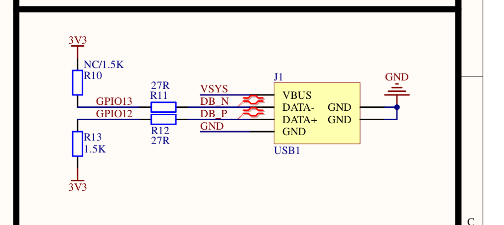

# RP2350-USB-Aで7355のCDC Hostを作るための資料と改造手順

調査日: 2026-11-16 JST。対象はユーザー指定の[Switch Science SKU 10275 / WAVESHARE-30274](https://www.switch-science.com/products/10275)、Waveshare RP2350-USB-A。QR用RP2350-USB-Cとは別個体を使い、USB-Aから7355背面USB-Bへ接続する同一案件の継続。

## 結論

**CDC Hostとして使う構成は成立する見込みがあるが、出荷状態のまま完成品として使えるとは判断しない。公開回路と同じR13実装の個体なら、R13撤去によるHost専用化を基本案とし、CDC Host FWを別途作成する。**

メーカーFAQがR13撤去を明記しているのは、Hostのホットプラグ、およびLow-Speedキーボード/マウスの無応答に関する条件。7355はFull-Speed機器であり、今回の固定接続CDCで「R13ありでは絶対に動かない」と実証した資料ではない。一方、回路図ではHost側D+が1.5kΩで3V3へ引かれているため、Host専用基板からこのプルアップを除く方針が妥当と判断する。現物の版・実装と一致することを確認してから施工する。

|項目|今回の判断|根拠・適用範囲|
|---|---|---|
|R13 1.5kΩ|実装あり・公開回路と一致なら撤去する基本案|公式FAQと回路図。USB-A側D+のDevice用プルアップ|
|R10 NC/1.5kΩ|未実装のまま維持。現物実装は照合|回路図ではD−側の選択プルアップ。Hostへ追加しない|
|R11/R12 各27Ω|維持|USB-A D−/D+の直列抵抗。撤去対象ではない|
|QR基板で行ったCC抵抗の変更|USB-A側では不要|USB-AコネクタにCC端子はない。USB-C側R5/R6は書込み/Device用として維持|
|D+/D−外付け15kΩプルダウン|今回一律必須とは確定しない。電気条件・採用FWを評価して判断|公開回路に外付けはなく、既存PIO実装はGPIO内蔵pull-downを有効化。内蔵pull-downだけでUSB規格適合を保証するものではない|
|給電/保護|接続方法の具体化が必要|USB-A VBUS、Type-C VBUS、5V端子が同一VSYS。原典上専用Host電源スイッチ/過電流/逆流防止素子は見当たらない|
|CDC Host FW|必須|メーカーHID→Device CDCデモは7355 CDC Host用FWではない|

## 集めた資料

原典とダウンロード履歴は[資料フォルダと台帳](../../../../reference/USB_Host_SubMCU_20261116_RP2350_USB_A/README.md)へ保存した。既存QR基板の回路図・旧調査資料・7355マニュアルは変更していない。

|資料|用途・確認範囲|
|---|---|
|[メーカー回路図 PDF](../../../../reference/USB_Host_SubMCU_20261116_RP2350_USB_A/RP2350-USB-A.pdf)|1ページ。USB-A/Type-C/電源/GPIOのネットを抽出と画像で確認|
|[メーカーWiki HTML](../../../../reference/USB_Host_SubMCU_20261116_RP2350_USB_A/Waveshare_Wiki.html)|FAQのR13処置、C/C++デモ、依存版、書込み方法|
|[メーカーのR13位置写真](../../../../reference/USB_Host_SubMCU_20261116_RP2350_USB_A/Waveshare_R13_Location.png)|赤丸・矢印の原画像を保存。今回個体の部品位置は現物照合する|
|[ピン配置図](../../../../reference/USB_Host_SubMCU_20261116_RP2350_USB_A/Waveshare_Pinout.jpg)|端子の5V/GND/3V3、UART候補、GPIO16のRGB使用を確認|
|[メーカーDemo ZIP](../../../../reference/USB_Host_SubMCU_20261116_RP2350_USB_A/RP2350-USB-A.zip)|展開物も保存。HID Host→Device CDCの構成とPIOピンを読解。実行・書込みはしていない|
|[RP2350ハードウェア設計資料](../../../../reference/USB_Host_SubMCU_20261116_RP2350_USB_A/Hardware-design-with-rp2350.pdf)|公式Wikiが案内するRaspberry Pi資料。必要節を今後参照するため保存。全頁レビューではない|
|[Pico C/C++ SDK資料](../../../../reference/USB_Host_SubMCU_20261116_RP2350_USB_A/Raspberry-pi-pico-2-c-sdk.pdf)|同上。FW開発の参照用として保存|
|[TinyUSB CDC公式説明](../../../../reference/USB_Host_SubMCU_20261116_RP2350_USB_A/TinyUSB_CDC.html)と[Host例](../../../../reference/USB_Host_SubMCU_20261116_RP2350_USB_A/TinyUSB_Host_CDC_Example.html)|CDC Host・制御線・line coding・送受信の説明。最新版の機能を固定版へ無条件適用しない|
|[固定SDK/PIOソースの台帳](../../../../reference/USB_Host_SubMCU_20261116_RP2350_USB_A/local_source_manifest.json)|現在案件のSDK2.2.0とQR側vendorからCDC Host/HCD/PIOの関連11ファイルを別途コピーしhash照合。依存一式を再配布したものではない|

販売ページはWeb閲覧でSKU/商品コード/回路図リンクを確認。ファイルとしての取得はHTTP429で失敗したため、販売ページHTMLを保存済みとはしない。メーカーWiki等の主要資料は別途取得成功し、失敗も台帳に残した。

## 原典回路で確認した事実

### USB信号と端子

USB-A J1のDATA+はDB_P→R12 27Ω→GPIO12、DATA−はDB_N→R11 27Ω→GPIO13。R13 1.5kΩはGPIO12側から3V3へ接続。R10はGPIO13側から3V3へのNC/1.5kΩ選択部品。

Type_C1の信号はRP2350のネイティブUSBへ接続。R5/R6各5.1kΩはCCからGNDへ接続される。**7355をUSB-Aへ接続する今回構成では、Type-CをHost化するCC施工は行わない。** メーカーFAQのR13撤去後にDeviceとして使えなくなる対象はPIO側USB-Aであり、ネイティブType-CのBOOT/書込み経路とは分ける。

USB-AはPIO Host側roothub1を使う構成がサンプルにある。pin_dp=12、D−=13、DPDMを前提候補とし、USB-A実機FWで照合する。ネイティブUSB Host/roothub0を使った旧Type_C1向け検討は今回のUSB-A用設定に流用しない。

### 電源

回路図ではUSB-A J1 VBUS、Type_C1 VBUS、P1の18番VSYSが同じネット。P1 17番がGND、16番が3V3で、ピン配置図の電源表示は5V/GND/3V3である。VSYSを3.3Vで給電してもUSB-Aへ必要な5Vは生成されない。**今回のUSB Host評価は適切な5V系から給電し、3V3端子へ5Vを入れない。**

USB-Cと外部5Vを同時に直結すると給電源同士が接続される。PC書込み時は外部電源を切り離し、通常評価ではPC Type-Cを切り離して外部5Vを使用する運用を基本案とする。同時PCデバッグが必要なら電源分離/逆流防止を別途設計する。

U1の500mA LDOは3V3生成用であり、USB-A VBUSが500mAに制限/保護される意味ではない。7355がAC自己給電でもUSB端子のVBUS検出・電流・逆給電は実機で確認する。以前のQR単体評価での保護条件に関するユーザー指定を、未確認の新基板へ自動転用しない。

### メーカーFAQと版の扱い

メーカーFAQはHostでのホットプラグ・Low-Speed無応答にR13撤去を案内し、撤去後のPIOポートDevice利用不可も記載している。固定接続の今回評価でホットプラグ受入を必須へ追加しない。

FAQにはRP2350 A4との回答があるが、保存した公式R13位置写真のチップ表記はA2である。写真は位置の参考とし、今回個体のシリコン版や改良済み実装を写真/FAQだけで確定しない。

## FWで必要な変更と使える材料

公式`host_hid_to_device_cdc`は**USB-AでHIDを受け、ネイティブType-CのCDC DeviceからPCへ出す**サンプル。`CFG_TUD_CDC=1`はPC側Deviceの設定であり、7355を制御する`CFG_TUH_CDC`とは異なる。公開サンプルのHost設定はHIDを有効にしており、7355へのCDC Host送受信は実装されていない。

必要な開発は次のとおり。

1. RP2350-USB-A専用のC/C++ CDC Host FWをQR版とは別のproject/成果物として用意。固定SDK2.2.0を出発点に、PIO driver/HCD APIの整合を確認する。GPIO12/13はUSB専用、GPIO16はRGB使用としてUART割当てから除外する。
2. PIO USBを初期化しHost taskを継続実行。メーカー例は120MHzを使用しており、既存PIO実装に合うクロックを固定する。商品の最大CPU150MHzという記載だけでPIO USBを150MHz動作へ変更しない。
3. `CFG_TUH_CDC=1`でCDC ACMを有効化。7355のVID:PID=1334:0309、CDC通信/データinterface、endpointと記述子全体を実機取得して識別する。
4. 固定版の`CFG_TUH_CDC_LINE_CONTROL_ON_ENUM=0x03`または対応する制御APIでDTR/RTS両ON、line codingを9600/8N1へ設定。USB制御転送の完了を確認してからコマンド送信へ進む。PCのCOM24番号はHost MCUでは使用しない。
5. `tuh_cdc_write`/flush/read等で部分送受信・CRLF終端・timeout・切断・遅着を管理。USB処理をUART出力待ちで止めず、RAM Queueで診断を出す。
6. 初回はIDN原文照合、その後は[保存済み7355電圧試験手順](../CDC_Settings_Voltage_Quick_Test_Rev0.md)へ進む。7355本体のBUS=CDC/LANG=SCPIは前面確認が必要。ADC形式で取得を代用しない。
7. 親Picoとの独立双方向UARTは単体CDC成立後に正式契約へ接続。GP0 TX/GP1 RXは出力図上の候補だが、baudrate・正式pin/APIは未確定。ATE UART0/NF55G UART1は維持する。

メーカーWikiはDemo0.5.3/SDK2.1.0を記載する一方、取得ZIPの`library.properties`は0.5.2表記。ZIP SHA-256は10月14日保存版と一致した。版名を推定で揃えず、実際のソース・依存版・hashで管理する。

WikiにあるHCDの`return`削除は今回の採用手順にしない。現固定SDKのHCDはframe番号/abortの戻り値を返す実装で、QR側vendorに対応関数が存在することを確認した。ただしCDC HostとしてのARMビルド・動作確認は今回未実施。既存QR FW/依存原典を改変して新基板へ書き込まない。

## 改造と初回評価の実施順

以下は具体化した施工・受入手順案で、今回の作業で施工や機器操作を行った記録ではない。

|段階|実施内容|確認・保存するもの|
|---|---|---|
|A0 個体確認|型番・基板版・チップ表記、R13/R10実装と公式位置図を照合|今回個体の識別と施工前写真。版が違う場合は部品を推定して撤去しない|
|A1 初回書込み経路確認|外部5Vと7355を外し、Type-CからPCへ接続。対応手段で識別・元Flash退避を行う|識別/Flash退避/使用ツール。既存QR個体を対象にしない|
|A2 無給電施工|PC/外部電源/7355/給電し得るUART adapterを全て外し、R13だけを撤去（実装確認できた場合）。R10はNC維持、R11/R12は残す|施工前後の写真、取り外し部品、パッド剥離/半田ブリッジなし。R13パッドを短絡しない|
|A3 給電単独確認|供給元を1つに限定。外部5VとGND/極性/枝の保護条件を確認し、機器未接続で5V/3V3と異常発熱・resetを点検|測定点と電圧・電源経路。外部5VとPC VBUSを同時直結しない|
|A4 CDC用FW配置|外部給電を外してPC書込みモードへ。対象専用の検証済みFWを配置し版・内容照合|版・個体・hash・verify。現時点では対象FW未作成|
|A5 固定接続で起動|全て無給電でUSB-A–Bケーブルを7355へ接続。PC Type-Cを外し、診断受信を準備して外部5Vで起動|mount/USB速度/descriptor、DTR/RTS・line coding完了、起動差と電圧|
|A6 IDN→単発測定|`*IDN?`+CRLFの識別後、既知低電圧で20V/200V/AUTO・READ?を逐次試験|識別応答・設定/測定原文・前面表示・エラー/timeout。NF55Gへは書き込まない|
|A7 親との接続|2基板の独立UART・要求/試行相関を実装し結合試験|取得→Cache→ATE確認→別書込み、書込み完了/TEST_ENDで破棄。通信Timing・遅着除外|

R13の正しい位置は[メーカー写真](../../../../reference/USB_Host_SubMCU_20261116_RP2350_USB_A/Waveshare_R13_Location.png)を参照する。メーカーFAQのHost専用化案を具体化したものであり、現物のR13が未実装ならその撤去作業は不要。外付け15kΩを追加する場合はD+/D−の各GND側への条件と位置を別途確定し、R13パッドへそのまま置換しない（R13の反対端は3V3）。

## 2026-11-19 共用外部電源と実作業順の追記

ユーザー指示により、外部測定器HostもQR用と同じ外部電源で給電する。既存記録上の電源は多摩電子工業DC5V/2.4Aという申告値。これは出力定格の記録であり、実際の電流制限値、アダプタ・Expander分岐の保護、追加Hostと外部測定器を含む同時負荷の成立は未確認のままとする。

実作業は次の順で進める。回路・電源の確認と無給電での部品照合を先に行い、結果を記録してから部品処置へ進む。

1. 対象基板の型式・版・個体を確認し、回路図でUSB-A D+／D−、VBUS、GND、開発用USB-C、5V/VSYS、3V3端子と電源ネットを照合する。USB-A側にCC端子はないため、USB-C側のCC部品をUSB-A Host化のために変更しない。RESETは接続仕様・現物対応を確認し、挙動を推測しない。
2. PC、外部電源、QR、外部測定器、デバッグUARTを全て切り離して無給電を確認する。D+/D−、VBUS/GND、外部電源入力、RESETの配線位置を現物と配線図で確認する。通電状態で抵抗・導通測定やはんだ作業を行わない。
3. R13位置がメーカー図と現物で一致し、R13が実装されている場合に限り、Host専用化案に沿ってR13だけを撤去する。R10は未実装のまま、R11/R12は維持する。パッド位置や部品が一致しない場合は作業を止め、推測で別部品を外さない。実装後は短絡・ブリッジの有無と写真を記録する。
4. 電源を一系統だけ接続して無負荷の電圧と異常発熱・リセットの有無を記録する。USB-A VBUS、開発用USB-C VBUS、5V/VSYSは原典回路上共通ネットなので、PCのUSB-Cと外部5Vアダプタを同時に直結しない。書込み時は外部電源を切り離し、通常評価時はPC USB-Cを切り離す。
5. USB-A Host基板だけ、次に外部測定器、次にQRを追加し、最終的にQR・Host・外部測定器を同じ外部アダプタで同時動作させる段階試験を行う。電圧降下、総電流、コネクタ・配線の温度、リセット、異常を記録する。測定器の電流レンジを電源間へ直接接続しない。合否限界は部品・配線の定格と合意済み基準で定め、未確認の1A枝保護や2.4A定格だけから合格としない。

ここでいう同時負荷試験は、複数機器を一つの共用外部電源で動作させる試験を指す。開発用USB-CのPC給電と外部電源を同時接続する試験は、共通ネットへの二電源直結となるため対象外。電源分離・逆流防止・電流制限を含む回路を別途確認・実装し、通電前に検証できた場合に限り、別工程として計画する。

実機の確認・はんだ作業・給電測定はユーザー側で実施する必要がある。この記録の更新だけで部品が撤去済み、追加部品が実装済み、または複合負荷試験が実施済みとは扱わない。

## 2026-11-19 基板入手・回路確認の進捗

ユーザー報告により、対象のWaveshare RP2350-USB-Aを入手し、回路を確認済み。現在、PCと当該基板をUSB-Cで接続している。

これは基板入手・回路確認・物理接続の報告であり、基板版／チップ表記の照合、WindowsでのUSB列挙、USB serial確認、Flash退避、FW書込み・verifyの完了を意味しない。これらの結果はそれぞれ確認後に記録する。USB-A側のHost回路部品処置、外部電源接続、外部測定器接続も別工程として未確認のまま。

### PC列挙の初回確認

2026-11-19、PC上で接続中PnPデバイス、USB機器、COMポート、リムーバブルボリュームを読み取り専用で確認した。VID `2E8A`／RP2350・RP2／Picoに該当する機器、対応COMポート、RP2/BOOTSELドライブは一覧に現れなかった。列挙エラーまたはUnknown USB Deviceも確認されなかった。したがって現時点では、PC接続はユーザー申告として記録するが、Windowsによる基板認識は未確認（今回の列挙では未検出）とする。原因はケーブル、ポート、給電、BOOTSEL状態のいずれとも断定しない。

次は基板の開発用USB-C端子とデータ対応ケーブルを再確認し、必要なら取扱手順に従いBOOTSELへ入れて再列挙する。機器がWindowsに現れ、USB serial/ボリュームと個体識別を確認するまでは、Flash退避・書込み・Host FW配置へ進まない。外部5Vは切り離し、外部給電との同時接続を避ける。

### 通信ケーブル交換後の再検出

ユーザーがケーブルを通信対応品へ交換した後、2026-11-19に再列挙した。WindowsでUSB親デバイス `VID:PID=2E8A:0009`（REV_0100、表示名`Pico`）とCDC interface `Board CDC`（COM25、interface 00）を検出し、PnP状態はOK。USB instance ID末尾は`BFCF2EDB84B0B37F`。このPnP表示はUSB CDC接続の成立を示すが、商品型式WAVESHARE-30274や基板版の個体識別を単独で証明するものではない。

この確認時点ではBOOTSELデバイス（VID:PID `2E8A:000F`）およびRP2リムーバブルボリュームは見えていない。COM25は開いておらず、データ送信・Flash読出し／書込み・reset操作は行っていない。次は外部5Vが切り離されていることを確認し、PCの開発用USB-Cを接続したまま基板上のBOOTSEL手順で再列挙する。BOOTSELで個体・Flash容量を照合し、Flash退避を完了するまでは書込みに進まない。

### RESET/RUN操作後の再確認

ユーザーからRESET/RUN操作完了の報告を受け、2026-11-19に再列挙した。引き続きCOM25／VID:PID `2E8A:0009`、製品表示`Pico`、PnP状態OKであり、BOOTSEL VID:PID `2E8A:000F`およびRP2ボリュームは検出されなかった。このため通常CDC起動状態のままで、BOOTSEL移行は確認できていない。COM25を開く操作、送信、Flash操作は行っていない。

次は外部5Vが切り離されていることを確認し、BOOTボタンを押したままRUN/RESETを一度押して離し、その後BOOTを離す手順で再試行する。操作後にBOOTSEL列挙とドライブを再確認し、現れるまではFlash操作へ進まない。

### BOOTSEL再検出結果

上記のBOOT保持付きRESET/RUN操作後、2026-11-19にBOOTSELを検出した。WindowsではUSB composite `VID:PID=2E8A:000F`、`RP2350 Boot`、PnP状態OKを確認し、E:にラベル`RP2350`、FAT、約134MBのリムーバブルボリュームが現れた。USB instance ID末尾`BFCF2EDB84B0B37F`は通常CDC起動時の値と一致する。

`INFO_UF2.TXT`の内容は`UF2 Bootloader v1.1`、`Model: Raspberry Pi RP2350`、`Board-ID: RP2350`。これはRP2350のBOOTSEL認識を確認する情報であり、WAVESHARE-30274のSKUや基板改版の固有識別ではない。Flashバックアップ／消去／書込み、picotoolによる情報取得はまだ行っていない。個体の現物表示・版を照合し、Flash退避手段と保存先を確認してから次工程へ進む。

### 対象Flash退避とR13作業開始条件

2026-11-19、BOOTSEL上の対象serial `BFCF2EDB84B0B37F`を指定してpicotool v2.2.0-a4で全Flashを読み取り退避した。2,097,152 bytesを保存し、`save -a -v`のFlash照合は`OK`。退避ファイルは[WAVESHARE-30274_BFCF2EDB84B0B37F_flash_2MB.bin](Flash_Backup_20261119/WAVESHARE-30274_BFCF2EDB84B0B37F_flash_2MB.bin)、SHA-256は`1b90c7066b977f42d163b59d115742dbb56ba618f5e76862f91f2a490733b474`。対象情報と照合結果は[manifest](Flash_Backup_20261119/manifest.json)に記録した。picotoolの`info -a`ではRP2350 A4、Flash 2048K、現行イメージ`usb_device`／SDK 2.2.0／`pico2`を確認した。

退避hashは既存RP2350-USB-C個体の初期Flash退避hashと一致したが、今回のchipidは`BFCF2EDB84B0B37F`で、既存QR個体の`A06FEA01012EC137`とは異なる。Flash内容hashの一致をもって基板個体を同一視しない。今回の操作はFlash読出しのみで、消去・書込みは行っていない。

ユーザーからR13撤去はいつでも可能との指示を受領し、作業承認済みとして次工程へ進める。ただし、はんだ作業自体は実機で行う必要がある。施工時はPC USB-C、外部電源、外部測定器、QR、UART adapterを全て外して無給電にし、R13位置をメーカー位置写真と現物で照合する。基板の向きと部品番号が一致し、R13と確実に特定できた場合のみR13だけを撤去する。R10/R11/R12、USB-C側部品は変更しない。部品特定に迷う場合は作業を止めて写真で再確認する。撤去部品と施工前後の写真を保管し、はんだブリッジやパッド損傷がないことを確認するまで再給電しない。

2026-11-19 施工進捗: ユーザーよりR13撤去完了の報告を受領。撤去完了は申告として記録する。施工前後写真、R13位置の照合証跡、パッド状態、はんだブリッジ有無、R10/R11/R12の保持状態は本報告だけでは確認できない。再給電・通電確認は未実施として扱い、外観確認と電源経路確認が済むまで外部電源を接続しない。

2026-11-19 無負荷電圧確認: ユーザーより基板の5V-GNDおよび3V3-GNDの電圧に異常なしとの報告を受領。数値・測定条件・接続状態は未提示のため、報告値の定性的な記録とする。無負荷電圧確認は給電容量、電流制限・分岐保護、負荷時電圧、USB Host動作の受入を意味しない。

### 専用CDC Host診断FWのビルド

2026-11-19、既存QR用PIO-HID FWとは分けた`firmware/usb_submcu_external_meter_host/`を新設した。SDK 2.2.0でRP2350 ARM Secure向けbuild/linkに成功。UF2=83,968 bytes、SHA-256=`6ee5eb6ec31b2d9277d562fccac3af1e62720df5f56319cf23c39dbc0edc0ff0`。版`meter-host-diag-20261119.1`、固定board profile、SDK、ELF/BIN/UF2のhashは[build manifest](../../../../firmware/usb_submcu_external_meter_host/build_manifest.json)を参照する。

診断FWの機能はUSB-A PIO Host列挙、対象7355のVID/PID照合、CDC設定9600/8N1とDTR/RTSの転送完了確認、識別Query一回、応答raw hexのGP0診断出力まで。固定SDK内の`hcd_init`、`pio_usb_host_init`、CDC mount/control APIをリンクしたことをELFで確認した。Host/Mock 375件も成功したが、この結果は新FWのUSB動作試験ではない。

2026-11-19時点ではUF2未配置であり、実機CDC列挙/IDN・診断UART受信も未実施だった。以降の配置結果は次項に記録する。作業直前のR13撤去報告は記録済みだが、施工写真・パッド状態・周辺部品確認、共用外部電源での実負荷/保護受入は未確認。

### 診断FWの初回配置（2026-11-20）

ユーザー確認で外部5Vを切り離し、USB-A機器・QR・診断UART変換器も基板から外した状態として、BOOTSEL対象serial `BFCF2EDB84B0B37F`へ診断UF2を配置した。コマンドは`picotool load -v <uf2> --ser BFCF2EDB84B0B37F -f`、picotool v2.2.0-a4。Flash verifyは`OK`となり、picotoolはアプリケーションモードへ戻したと報告した。対象UF2のSHA-256は`6ee5eb6ec31b2d9277d562fccac3af1e62720df5f56319cf23c39dbc0edc0ff0`で、事前確認したbuild manifestと一致。事前Flash退避は2MiB全域・verify済み。

本FWはネイティブUSB CDC Deviceを無効にしているため、通常起動後にRP2350のCOM25が現れないのは想定どおり。SH-U05AはCOM22としてPnP状態OKで認識されている。capture #07ではUSB-A–USB-Bケーブル経路と7355 BUS=CDCを確認後、7355をUSB-A Hostへ固定接続しPC USB-Cを外して30秒採取した。raw `temp/meter_host_com22_capture_20261120_07.raw`は436 byte、SHA-256=`cac1ab22e6655a323671938428ce66037773c6bd3cc140867f9c394445f5222b`。VID/PID `1334:0309`のUSB/CDC mount、9600/8N1、DTR/RTS ON、`*IDN?`一回送信、CRLF終端32 byte応答を確認した。実測IDNは`ADC Corp.,7355,246410099,  A02`。以前の期待IDN`ADC Corp.,7355,246410072,  A01`は別の7355個体の値であり、ユーザー確認により今回のシリアル/版差は想定内。4回目のUART起動ログは`temp/meter_host_com22_capture_20261120_04.raw`を参照。

6回目はUSB mountがなかったが、ケーブル経路とBUS=CDCを確認後の7回目でCDC/IDN応答まで成立した。次段階は測定コマンド確認。送信前に7355前面でLANG=SCPIを確認し、既知の低電圧DC入力とV/COM接続、入力値を記録する。現FWはIDNのみ自動送信するため、測定コマンドを実行するには別途試験用の実装・検証が必要。未確認の測定条件や復元値を推測してコマンドを送らない。

外部電源の共用先と電気保護、R13撤去部の施工状態は未確認。USB/CDC/IDN通信は成立したが、7355の測定値取得は未実施。測定試験に進む前にLANG=SCPI、既知の低電圧入力、測定端子接続を確認し、電源Open Issueは維持する。

## 未確認事項と残Issue

- 今回個体の入手/基板版/R13実装/改造状態、シリコン版。
- 7355のFull-Speed CDCでの起動・列挙・制御転送・連続応答。PC直結の成功は新Hostの受入ではない。
- 給電容量/突入/枝保護/USB側負荷/逆給電、実装の電気条件。外付けプルダウン追加の要否と規格適合。
- 新Host FWの版固定・ビルド・配置、独立双方向UARTと親PIO資源・正式API。
- 校正AD/AR・QR/SSの未確定変換と反映時期は従来Issueを維持。今回の基板選定で解決扱いにしない。

USB-SUB-05に今回の基板資料・施工案を関連付け、USB-SUB-02等の給電/保護課題を維持する。旧1基板2 HostのUSB-SUB-03は今回構成の必須条件に戻さない。

## 今回の変更と検証

原典9件（Wiki/回路図/ZIP/CDC説明2件/位置図2件/設計資料2件）を取得し、全件のサイズ・SHA-256を記録。ZIP36エントリを確認・展開し、過去のメーカーZIPとhash一致。関連ローカルソース11件はコピー元とhash一致。回路図を描画してUSB-A・電源・ピンを画像確認、メーカー位置写真/ピン配置も目視確認した。販売ページは閲覧確認のみ、HTML取得は429として台帳に残す。

収集用scriptはPython構文確認、資料manifest/hash/PDF・ZIP形式/参照リンクを検査。FW/量産コード/実配線を変更しておらず、Host Unit/Mock NF55G・ARMビルド・実機試験は今回実行していない。施工済み・CDC Host完成とは報告しない。
