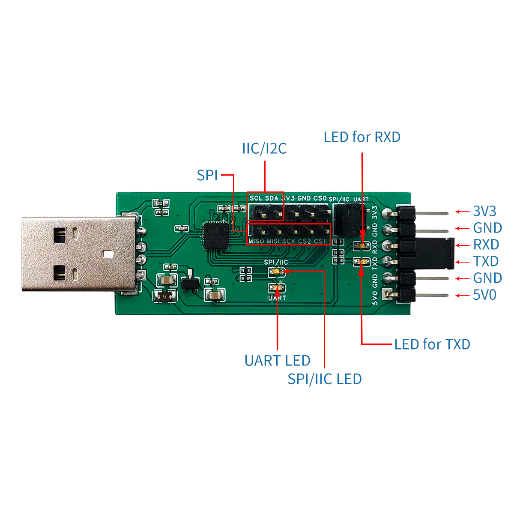

# SH-U05A 配線・設定・ログ受信手順 Rev.1

日付: 2026-11-11／対象: 所持済みSH-U05Aと追加RP2350-USB-C
旧版: [接続準備Rev.0](SH_U05A_Debug_Setup_Rev0.md)を履歴として保持。

## 1. 作業範囲と現在の状態

**今はSH-U05A単体のUART設定・COM確認まで実施できる。追加基板への配線・給電は、改造・電源確認・UART版FWの準備後、実機確認直前の案内に従う。**

- ユーザー確認事実: SH-U05Aは所持済み。
- メーカー確認事実: CH341F、TTL信号3.3V、UART 50bps～2Mbps、UARTモードではUART LED点灯。
- 未確認: 現物モード・ジャンパ状態、COM番号、受信品質、追加基板GP0の現物照合、電源枝の保護。
- 配布済みqr-probe-20261111.1-ramはUART出力なし。現在配置済みUSB単体診断FWもこの診断UARTを出さない。診断TX候補は構文検査までで、UART版のビルド・UF2配置・受入は今後。

親Pico 2は変更しない。この手順のGP0は追加基板のGPIOであり、親PicoのATE用GP0／GP1やNF55G用GP4／GP5へは接続しない。

## 2. 端子位置と配線表

USB-Aプラグを左、部品面を正面、端子を右にしてメーカー写真と照合する。



| 写真の上から | SH-U05A表示 | 初回診断の配線 |
|---|---|---|
| 1 | 3V3 | 接続しない |
| 2 | GND | 追加基板GNDへ（5番のGNDでも可、1本でよい） |
| 3 | RXD | 追加基板GP0／UART0診断TX候補へ |
| 4 | TXD | 接続しない |
| 5 | GND | 2番を使うなら接続しない |
| 6 | 5V0 | 接続しない |

番号は写真の上からの順序を示し、正式なメーカー端子番号とは称していない。実物のRXD／GND表示を優先する。色や向きだけで接続しない。

上部のモード選択ジャンパはUART側を使う。RXD–TXDをつなぐループバック短絡とは別物。公式写真のRXD／TXD付近にはキャップ状部品が見えるが、用途と現物実装は未確認。短絡がある場合は追加基板への接続前に解除する。

## 3. A：SH-U05A単体の設定・COM確認

1. SH-U05AをPCから外し、端子から外部配線をすべて外す。追加基板・親Picoにはつながない。
2. 現物表示に従い、モード選択ジャンパをUART側へ設定する。SPI/IIC側は使わない。ジャンパ操作はUSBを抜いて行う。
3. SH-U05AだけをPCのUSBへ挿し、UART LED点灯を確認する。SPI/IIC LEDだけ点灯するなら、USBを抜いてモードを再確認する。LED点灯だけを受信成功とはしない。
4. Windowsのデバイスマネージャーで「ポート（COMとLPT）」を開く。SH-U05Aの抜差しで増減する項目とCOM番号を記録する。以前のCOM6／COM20／COM21を流用しない。
5. ポートが出ない／不明なデバイスになる場合は、メーカー製品ページの案内からCH341のUART用ドライバを確認する。SPI/IIC用ソフトでの認識とUARTのCOM列挙を区別する。
6. COMを開くターミナル等は以下に設定する。同じCOMをターミナルとPythonで同時に開かない。

| 項目 | 設定 |
|---|---|
| ポート | 実際に識別したSH-U05AのCOM番号 |
| 速度 | 115200bps |
| データ長・パリティ・ストップ | 8bit・なし・1bit（8N1） |
| フロー制御 | なし。RTS/CTS・XON/XOFFとも無効 |
| ローカルエコー | 無効 |

この段階では追加基板が未接続なので、受信表示がなくても異常とはしない。確認が終わったらCOMを閉じ、SH-U05AをUSBから外す。

## 4. B：実機確認直前の配線・給電

開始条件: [治具図Rev.4の4・5枚目](../drawings/NF55G_Fixture_20261111_Rev4/README.md)による改造案内・施工後確認、外部5V枝の保護・極性確認、診断UART版FWの書込み照合が済んでいること。現在はいずれも実施した扱いにしない。

1. 追加基板の外部5VをOFF。Type_C1のPCケーブル、7355、SH-U05AのPC USBを外す。
2. 追加基板のGPIO表示「0」（GP0）とGNDを現物照合する。ICのパッケージ端子番号や親PicoのGP0と区別する。端子が確認できなければ推定で接続しない。
3. RXD–TXDの短絡がないことを確認し、GNDを先、GP0→RXDの信号を後に接続する。SH-U05AのTXD／3V3／5V0は未接続にする。
4. QRは追加基板の電源OFFでType_C2へ固定接続。QR単体試験ではType_C1は空、7355は接続しない。
5. 追加基板OFFのままSH-U05AをPCへ挿し、正しいCOMで受信・ログ保存を開始する。片側無給電時の信号条件も現物確認対象として記録する。
6. 受信待ちにしてから追加基板の外部5Vを投入する。SH-U05AはPC USB、追加基板はExpander分岐から給電する。

```text
PC USB ── SH-U05A RXD ←── 追加RP2350 GP0（診断TX候補）
                  GND ─── 追加RP2350 GND
外部5V ── Expanderの保護した分岐 ── 追加基板5V／GND
追加基板Type_C1：PC接続なし、QR単体時は空
追加基板Type_C2：QRを無給電で接続後、電源投入
```

**SH-U05Aの3V3／5V0から追加基板へ給電しない。追加基板Type_C1へPC USBを重ねて接続しない。** 外部5Vを3V3やGPIOへ入れない。正式な親子UARTのピン・プロトコルはこの診断配線とは別途確定する。

## 5. C：UART版FWでのログ保存

UART版FWの準備後に行う手順。ログはQR文字列そのものではなく、@＋HEX＋改行の診断レコード。ターミナルなら、受信とファイル保存を開始してから追加基板を電源投入する。

受信スクリプトを使う場合は、リポジトリ直下のPowerShellで以下を実行する。COM99は説明用なので、実COM番号へ置き換える。出力名も未使用のrun番号にする。

```powershell
& ./.venv/Scripts/python.exe scripts/usb_submcu_probe_capture.py --port COM99 --seconds 60 --output docs/USB_SubMCU_Host_Preparation_20261111/capture_run01.raw
```

- ターミナルを閉じてから起動。COMを開けないエラーがないことを確認して速やかに追加基板を電源投入し、短い1回の読取りを行う。スクリプトは受信中の画面表示なしで60秒後に閉じる。
- 待受が起動に間に合わなければ電源OFFし、run02等の未使用ファイル名で起動前から再取得する。既存rawは上書きしない。FileExistsErrorならrun番号を変える。
- 途中接続・boot欠落のログを完全な証跡としない。ログは256レコード上限のため、短い1読取ごとに取得する。

受信後のオフライン検査:

```powershell
& ./.venv/Scripts/python.exe scripts/usb_submcu_probe_log.py docs/USB_SubMCU_Host_Preparation_20261111/capture_run01.raw --format uart --output docs/USB_SubMCU_Host_Preparation_20261111/capture_run01.json
```

起動・個体ID・機器情報・HID記述子・HID原文を確認する。boot欠落、連番飛び、破損、満杯、受信要求失敗はそのまま調査する。raw_capture_onlyは原文取得の範囲で、hardware_acceptance=false／qr_text_verified=false。QR35文字一致や製品PASSへ昇格しない。UART単独では末尾欠落やRAM破棄数を証明できず、tail_completeness=not_provenも残る。

## 6. 終了・切り分け

終了は、追加基板の外部5VをOFF→COMを閉じる→SH-U05AをPCから外す→信号線→GNDの順。QRの向き変更・再接続も電源OFFで行う。

| 症状 | 確認すること |
|---|---|
| COMが現れない | UARTモード、SH-U05A単体でのUSB列挙、UART用ドライバ |
| COMを開けない | 別ソフトの占有、実COM番号、抜差し後の番号変更 |
| UART LED点灯・受信なし | UART版FW、起動前待受、GP0→RXD、GND。RAM版／現在のUSB診断FWはUART出力なし |
| 文字化け | 115200／8N1／フローなし、TTL3.3V、GND、現物端子 |
| boot欠落・連番エラー | 待受と電源投入の順序、1回分の取得、満杯、途中接続 |
| 発熱・電圧低下・reset | 電源OFFし、電源端子未接続、二重給電、極性・保護枝を確認 |

親PicoのFWを書き換えて切り分けない。DB_N／DN1など微細USB端子の測定は要求しない。

## 7. 実施記録

| 項目 | 現在の状態／記入欄 |
|---|---|
| SH-U05A所持 | ユーザー確認済み |
| UART設定・UART LED | 未確認 |
| 実COM番号・デバイス表示名・ドライバ | 未確認 |
| 現物RXD／GND・短絡解除・追加基板GP0照合 | 未確認 |
| UART版FW名・UF2 SHA・書込み照合 | 未実施 |
| 外部5V枝の保護・極性・1系統給電 | 未確認 |
| raw／json保存先・エラー件数 | 未実施 |

今回の検証はメーカー保存資料と現行ビルド・受信・解析スクリプトの照合、ローカルリンク確認のみ。コード変更なし、Host／Mock再実行なし、COM操作・ドライバ導入・改造・書込み・実機受信なし。USB-SUB-01／02／03はOpenのまま。

根拠: [メーカー仕様](https://www.deshide.com/product-details_1663317.html)／[保存原典・hash](../../reference/USB_Host_SubMCU_Host_Conditions_20261111/SH-U05A/manifest.json)／[FW準備結果](Result.md)。

## 2026-11-11 単体確認結果

ユーザーがUART側設定済み・UART LED非点灯と回答。PC側でUSB-SERIAL CH341 (COM22)、PnP問題コード0、WCH3.9.2024.9を確認。115200／8N1・フローなし、DTR／RTSともFalseでopen→無送信の1秒read→close成功、受信0byte。[結果と証跡](SH_U05A_Single_Check_20261111/Result_Rev0.md)。COM22は今回の識別値。以後の受信ソフトでも同じ通信条件を設定する。LED再確認・ループバック・追加基板通信は未実施、UART版FWと改造準備を待って追加基板へ接続する。

### UART LED点灯確認の追記（2026-11-11）

ユーザーがUART LED点灯を確認。前回のCOM22／PnP正常・115200／8N1開閉成功と合わせ、SH-U05A単体設定・COM確認は完了。[更新結果Rev.1](SH_U05A_Single_Check_20261111/Result_Rev1.md)。今回COM再操作なし。ループバック・追加基板受信は未実施で、追加基板接続は従来の実機前準備後に行う。

## 2026-11-11 単体ループバック完了

ユーザー申告のTXD–RXD短絡を用い、COM22／115200・8N1で112項目、送受信各5113byteが完全一致。COM解放済み。[結果・原文](SH_U05A_Loopback_20261111/Result_Rev0.md)。USBを抜いてTXD–RXD短絡ジャンパを外すよう案内。UARTモード選択ジャンパは維持。短絡除去の実施確認、追加基板接続・UART版FW配置は未実施。

## 工程② UART版FWの準備完了（2026-11-11）

[qr-uart-20261111.1](UART_FW_20261111/Result_Rev0.md)をビルド・配布用保存、GP0 TX／115200・8N1をバイナリ情報と照合。UART版リンク・配布は今回完了、実機配置・受信は未実施。旧版の「UART版は構文検査のみ」は今回以前の状態。TXD–RXD短絡除去の実施は未確認、改造・電源確認を先に行ってからUART版を書込み・配線する。
